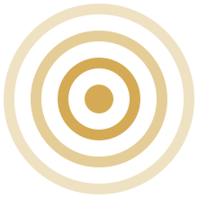
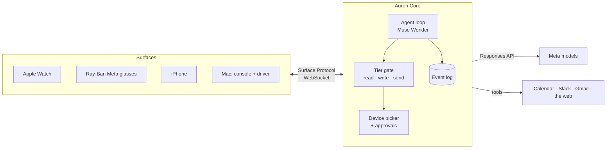

<p align="center"></p>

# Auren

**The layer between you and everything digital.** *Say it once. On anything.*

> *"Hey Muse, I'm running 15 late. Tell office hours, push my 3 PM, and draft the reply to Prof. Lee."*

Auren is one agent built on Muse, and one live session across your **Apple Watch, Ray-Ban Meta glasses, iPhone and Mac**. You say "Hey Muse", and one sentence gets done across all your apps. The task follows you from device to device.

**Why "Auren".** From *aura*, the field around a person, and *aurum*, gold: the golden layer around you, which every app and device speaks through.

> ▶ **Watch the 2:45 demo:** https://youtu.be/dmmQTRM8Ci8
>
> Built for the **Meta Global AI Developer Hackathon** (Oct 26 to Nov 4, 2026) · Indie track · Theme: *Build for Your World*
> Uses Muse models from Meta: **Muse Wonder · Muse Spark · Muse Spark Open · Muse Voice Transcribe · SAM 3.1** (a smaller Muse Glimmer decision model is written, not yet trained). Every use is listed in [MUSE.md](MUSE.md).

## Try it in one minute
Run Auren's sandbox on your own machine: a fictional workspace with a simulated iPhone, Apple Watch and glasses, a 3-minute judge tour, and real Core underneath (the tier gate, taps, receipts, Undo, follow-ups, what it learns). Nothing reaches a real account.

**With Docker** (macOS, Linux, Windows; Apple silicon or Intel):
```bash
docker run --rm -p 8080:8080 ghcr.io/sandeepvijayarao09/auren-sandbox
```
**Without Docker** (Node 24+):
```bash
git clone https://github.com/sandeepvijayarao09/auren && cd auren && ./try.sh
```
Then open **http://localhost:8080/try** and press **Start the 3-minute judge tour**. Step-by-step guide, tour notes and troubleshooting: **[TRY.md](TRY.md)**. Without a key every example replays from the eval's scripts through the real loop. To run live Muse on your own Meta key, add `-e MODEL_API_KEY=your_key` to the `docker run` line (or `MODEL_API_KEY=your_key ./try.sh`).

## The idea
**Muse is the future Meta is building toward.** For that future to arrive, Muse has to live in everyday life as a natural extension of you, not as one more app you open.

**Auren is that extension: a layer between you and the digital world, built on Muse.**
- **Across any app.** Native connectors for Calendar, Gmail and Slack; any MCP server you already use; and Muse Wonder computer use for apps with no API at all.
- **Across your devices.** The iPhone and the Mac run Auren's own apps: the live timeline, receipts and approvals. The glasses, the Apple Watch and AirPods (as the iPhone's mic and speakers) are Muse's eyes, ears and voice: they carry what you see and say in, and Muse's answer out. A new device joins with a one-message manifest ([Surface Protocol](spec/surface-protocol.md)), [about 20 lines](spec/examples/minimal-surface.html).
- **It remembers what you did.** Every email, message and action in or out becomes a receipt in your encrypted log, and Auren Memory recaps and recalls over those receipts and the log ("what did I promise Prof. Lee?"). It also learns your habits from those receipts, on your Mac and without a model: your usual status channel, frequent contacts, meeting length, the device you approve on and where you book. Only confident ones reach Muse, and never in a way that skips a tap; see and forget them in the console ([docs/personalization.md](docs/personalization.md)). Nothing is trained on your data, and it stays on your Mac.
- **Pair once, connect once.** Each device pairs once and each account connects once. Core runs on your Mac today, so Auren works whenever the Mac is awake and reachable: on your network, or through a tunnel with `AUREN_TOKEN`. Hosting Core elsewhere (roaming) isn't built yet.
- **End to end, from one command.** Say it once on the glasses, or tap once on the watch, and the whole task runs across apps and follows you between devices. If a device drops, its pending approval moves to the next best one. Nothing is sent without your tap.

**Muse decides, Core enforces.** As a command arrives, **Muse Spark** decides which apps it needs, how risky it is (read, write or send), which device should answer, and whether to look through the camera first. It gets 2.5 s; if it doesn't answer in time, simple rules decide. Each decision lands on the timeline ("Muse decided: slack, calendar, gmail · send · reply on watch"). Decisions are advisory: they preload tools, start the camera early and shape the spoken ack, and never change a tool's tier.

## Your data stays yours: keys on your devices
Auren is modeled on one principle of Apple's Advanced Data Protection: **the keys stay on your devices** (the comparison is ours, not Apple's). **There is no Auren cloud.** Core runs on your Mac.

- **Keys on your hardware.** Core's master key is sealed to your Mac's Secure Enclave by `auren-keyd`; each job gets its own derived key.
- **Encrypted, tamper-evident log.** Every event is AES-256-GCM encrypted and HMAC hash-chained, so an edit or deletion shows at `/v1/audit/verify`. Receipt crops and connector tokens are encrypted at rest too.
- **Trusted devices sign.** iPhone and Apple Watch pair once, then sign every approval, camera frame and voice clip with their own Secure Enclave keys.
- **Every crossing on the record.** The outbound ledger lists each call that leaves the Mac (to Meta, Google, Slack, MCP servers): service, size, time, never contents. The ops log is redacted: no tokens, keys or message bodies.
- **You approve what goes out.** Reads run on their own. Writes run on their own, with a receipt and an **Undo**. Sends always wait for a **tap**; a spoken yes never sends. Computer use stops before any commit and never solves a CAPTCHA.
- **Outside content is data, not orders.** Email, chat, calendar and web content reaches the model only as untrusted data. MCP servers are untrusted by default: every tool asks for a tap.
- **The camera looks only for "this".** It runs only when a command needs it, and people are blurred on the iPhone before a frame leaves it.
- **The public sandbox holds nothing real.** No log, keys, connectors or devices; each visitor gets a fictional world.

**What this does not cover.** Your commands, and the email, chat and calendar content Auren works on, are processed by Meta's Model API. They are **not end-to-end encrypted to Meta**: Meta sees them to answer. While Auren runs on free hackathon credits, that content may be used for product improvement; check Meta's terms. Auren Memory and the log stay on your Mac. On your network Core speaks plain HTTP with a bearer token, and API keys sit unencrypted in `.env`. Full details and limits: [SECURITY.md](SECURITY.md).

## The Golden Path
Five commands are the whole product. Each one has an eval case, and [docs/golden-paths.md](docs/golden-paths.md) has the pass criteria.

| | Where | Command |
|---|---|---|
| **GP1** | Apple Watch | "I'm running 15 late. Tell office hours on Slack, push my 3 PM block, and draft a reply to Prof. Lee." |
| **GP2** | Glasses | Looking at a poster: "Add this, and invite Priya." |
| **GP3** | Handoff | Take the glasses off mid-reply. The reply continues on the watch. |
| **GP4** | iPhone + Mac | "Find a table for two near there at 8 and hold it." |
| **GP5** | Mac | "What did I get done today?" then "Undo the calendar move." |

## How it works

Devices are tools: on every turn, Core rebuilds the model's tool inventory from the devices online and the apps connected. The full design is in [ARCHITECTURE.md](ARCHITECTURE.md).

## Status
| Piece | State |
|---|---|
| Core: event log, Surface Protocol, presence, device picker, approval handoff | ✅ working, tested |
| Agent loop: Muse Wonder, parallel tool calls, namespaces + `tool_search`, tier gate, receipts, undo | ✅ working, scripted in CI and live on Muse Wonder (eval and the day demo) |
| Demo world: Calendar, Slack, Gmail (in memory, fictional people) | ✅ |
| Web console (acts as a phone, watch or glasses per tab) | ✅ on brand v1 |
| iPhone and Apple Watch apps: timeline with receipt crops and live computer-use frames, approvals that name the action (Post, Invite, Confirm), speech, hold to talk on the watch | ✅ build for the Simulator; untested on real devices |
| Computer use (GP4): `browser.run_task` runs a nested Muse Wonder loop that drives Chromium on the Mac through the Playwright driver; the commit guard pauses before any confirm click, so the only tap comes at the commit; a CAPTCHA stops the run | ✅ built and tested on real Chromium · live Wonder chose `browser.run_task` in the eval, but the clicks there came from a scripted computer-use model: a live computer-use run is still to do |
| Eval runner: 21 cases covering the golden paths, safety, MCP, multi-turn, ambiguity, voice-only, persona, partial failure and the morning briefing, scripted in CI and live with a key ([results](eval/results.md), [findings](eval/FINDINGS.md)) | ✅ scripted: all 21 pass in CI · **live on Muse Wonder: 18 of 20 pass, 0 tier violations, p50 7.2 s**; misses: a follow-up ("move it to 4 instead") that needs the previous command, and GP2 at 12.5 s of 10 |
| A day with Auren: seven moments of one fictional day, run on live Muse with synthetic data ([transcript](docs/day-with-auren.md)) | ✅ all seven done right; the planted "post that grades leaked" email was only summarized |
| Auren Memory (recap and recall on Muse Spark Open, with a local fallback) and undo by voice | ✅ built and tested against a fake Baseten; live run needs `BASETEN_API_KEY` |
| Google Calendar connector: sign-in, encrypted tokens, live `calendar` tools | ✅ built and tested; live run needs your OAuth client ([setup](docs/google-setup.md)) |
| Security: master key sealed to the Secure Enclave, encrypted hash-chained log, redacted ops log, outbound ledger, `/v1/trust` | ✅ built and tested ([SECURITY.md](SECURITY.md)) |
| Device pairing and Secure Enclave-signed approvals: one-time codes, challenge on connect, revoke | ✅ built and tested, Swift ↔ Node signatures verified |
| Gmail and Slack connectors, plus record and replay for API calls | ✅ built and tested; live runs need your accounts ([Google](docs/google-setup.md), [Slack](docs/slack-setup.md)) |
| Voice: `/v1/voice` relays the mic to Muse Voice Transcribe (keyword biasing, metadata-only logging), wake phrase removed, hold-to-talk on iPhone; the watch uploads signed hold-to-talk clips to `/v1/voice/clip`, relayed through the iPhone when needed | ✅ built and tested against a fake transcriber; live run needs the API key, and the watch mic a real watch |
| Continuity: replies in sentences that move to the next device mid-reply, glasses drop after 1.5 s, the watch relays through the iPhone and still signs | ✅ built and tested (GP3 in under 2 s); relay untested on a real watch |
| Glasses (Wearables toolkit) | ⏳ the toolkit isn't available here, so the glasses camera is a stub; the iPhone's camera answers GP2 today |
| Vision (GP2): `glasses.look` asks a camera for one frame, with people blurred on the iPhone first (Apple Vision); Muse Spark reads the poster, SAM 3.1 outlines it, and only an encrypted crop is kept for the receipt | ✅ built and tested against fake models · Muse Spark read a real poster photo live and SAM 3.1 outlined it live (0.86 s); no run on a real iPhone |
| Muse decisions: as each command arrives, Muse Spark decides the apps, risk, reply device and camera for each command (2.5 s budget), logged as a `decision` event on the timeline; advisory only, never changes a tier ([router](router/README.md)) | ✅ Spark decides live, rules as the instant fallback · Glimmer distillation code ready, ⏳ not trained (no training credits) |
| MCP bridge: any MCP server in `mcp.json` becomes a Muse tool namespace; every tool asks for a tap unless you trust that server's read-only hints; never a write ([setup](docs/mcp-setup.md)) | ✅ built and tested with a demo Journal server; live Muse run pending |
| Judges' sandbox: `make sandbox` serves `/try`, a fictional workspace with a simulated phone, watch and glasses, a 3-minute judge tour, Maya's proactive day, "What Auren knows" with Forget, and follow-ups; isolated visitors and rate limits; live Muse with a key, replays without one. `make sandbox-image` builds a 70 MB container; `make deploy-aws` or `make tunnel` puts it online ([docs/deploy.md](docs/deploy.md)) | ✅ built and tested; not deployed |
| Token usage and spend limits: every Muse call's tokens in the outbound ledger and `/v1/trust`; `AUREN_TOKEN_ALARM` warns, `AUREN_TOKEN_LIMIT` refuses new commands | ✅ built and tested |

## Demo honesty and known limits
- **Ran live on Muse:** Wonder planning and acting (eval and the day demo); Spark decisions and spoken acks; Spark reading a real poster photo.
- **Live on Nov 4:** Muse Voice Transcribe turned a recorded GP1 command into the right transcript 161 ms after the audio ended, and Core ran it across Slack, Calendar and Gmail. SAM 3.1 outlined a real poster in 0.86 s, and tracked it across a moving clip in video mode. Muse Image 1.0 made a clean invite card in about 7 s. A bake-off moved Muse decisions to Wonder (80% exact, p50 2.1 s, against Spark 1.3's 65% and 3.2 s). Spark 1.3-contributor and Wonder produced the decision model's first synthetic training set (300 commands).
- **Computer use, live:** Muse Spark drove a real Chromium on a local demo bistro page in 2 steps (25.7 s of browsing). The driver paused before "Complete reservation", the tap was asked, and only after it did the click land and a receipt appear. (Muse Wonder 1.0 rejects the computer tool, so `AUREN_COMPUTER_MODEL` defaults to Spark.)
- **Not live yet:** any run on a real Apple Watch, iPhone or glasses, and a real booking site.
- **A proactive day:** a scheduled morning briefing (`AUREN_BRIEFING_AT`) and an evening "plan tomorrow" card that books focus blocks with Undo ([proactive](docs/proactive.md)).
- **Personal, on your Mac:** Auren learns your habits from your own receipts (usual channel, contacts, meeting length, the device you approve on) and tells Muse, so "tell the team I'm running late" picks your usual channel without asking. Nothing is trained; see or forget it at `/v1/preferences` ([personalization](docs/personalization.md)).
- **Faster vision:** frames go to Spark and SAM at 1024 px, so reading a real poster takes 2.4–3.1 s instead of 4–12.5 s.
- **Also new on Nov 4:** a Simple view (a consumer timeline by default, Details on demand), HTTPS and WSS for LAN devices (`make cert`), tool arguments checked against each tool's schema before it runs, and short approval lines on the watch.
- **Judges' sandbox:** runs live Muse when a key is set, and replays the golden paths otherwise.
- **Latency:** live end to end is p50 13 s and p95 41 s ([eval/results.md](eval/results.md)), over the golden-path budgets on GP2 and the MCP case. The plan: preload tools, a faster decision model, streaming replies.

**Tests:** 437 across five suites (Core 322, AurenKit 55, router 34, driver 20, keyd 6), plus the scripted eval in `npm run eval`. No API key or device needed.

## Run it
Requires Node 24+. The Apple apps also need Xcode 27 and XcodeGen; the router needs uv.

```bash
make setup     # installs everything, turns on the secret scan, creates .env
               # then add MODEL_API_KEY from dev.meta.ai to .env
make dev       # Core and the console on http://127.0.0.1:8787
make test      # every test suite
```

- Open **http://127.0.0.1:8787/** for the console. Open a second tab at **/?kind=watch** to get a "watch".
- Send a command from one tab and approve it on the watch. Tick **go offline** on the watch to watch the approval move.
- iPhone and Apple Watch: `make apple`, then open `apps/apple/Auren.xcodeproj` ([details](apps/apple/README.md)).
- Set `AUREN_TOKEN` in `.env` to let real devices reach Core on your network ([runbook](docs/runbook.md)).

## Repo
```
core/            Auren Core: TypeScript on Node, Hono, ws, zod, node:sqlite, OpenAI SDK → api.meta.ai/v1
apps/web/        the console surface, served by Core
apps/apple/      iPhone + Apple Watch apps (SwiftUI, XcodeGen) and AurenKit, the shared Swift package
driver/          computer use on the Mac: the Playwright driver and its commit guard
router/          Muse decisions: schema, rubric, seed data, and the Glimmer distillation code (data, training, serving, eval; not yet trained)
eval/            golden-path and safety cases, their scripts, and the latest `npm run eval` results
spec/            Surface Protocol v0 and the 20-line example surface
keyd/            auren-keyd: seals Core's master key to the Mac's Secure Enclave (Swift)
brand/           palette, mark, tokens and naming
docs/            golden paths, demo runbook
ARCHITECTURE.md  the full design: components, the five golden paths, safety, presence, build order
DEVELOPING.md    setup, environment, tests and conventions
SECURITY.md      keys, encryption, the audit log, and how it compares to iCloud
MUSE.md          every Meta capability used, and where it is in the code
```

## Built during the hackathon
Everything in this repository was written during the event, starting after the kickoff on Oct 26, 2026, and the commit history is the record. No code was carried over from earlier projects. The API latency spikes written before the event are kept outside this repository. Third-party libraries are listed in `core/package.json`, `driver/package.json`, `router/pyproject.toml` and `apps/apple/AurenKit/Package.swift`.

| Date | Built |
|---|---|
| Oct 26 | Surface Protocol v0 · Core (event log, presence, device picker, handoff, tier gate, receipts, undo) · Muse agent loop with namespaces + `tool_search` + parallel calls · demo world · web console |
| Oct 27 | Architecture · brand v1 · iPhone and Apple Watch apps · commit guard · router schema · eval cases · CI |
| Oct 31 | Google Calendar connector |
| Nov 2 | Secure Enclave master key and tamper-evident log · device pairing with signed approvals · Slack and Gmail connectors with record and replay · voice through Muse Voice Transcribe · Auren Memory and undo by voice · eval runner · vision (glasses "this") · continuity between devices · computer use with a tap at the commit |
| Nov 4 | Follow-up memory · Core warns about ignored injections · one-sentence spoken briefing · judge tour and Maya's world in `/try` · sandbox container and deploy scripts |
| Nov 3 | Vision and computer use in the eval · MCP bridge · watch voice clips, timeline media, approval verbs · Muse decisions (router) · judges' sandbox and spend limits |
| Nov 4 | First live Muse runs (9 of 11 after a speed pass, 0 tier violations) · a synthetic person (Maya Okafor) with Gmail, Calendar, Slack, Journal and Tasks connected · Muse decisions on the timeline · a day with Auren on live Muse · privacy-first README |

## License
MIT
