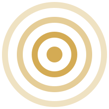
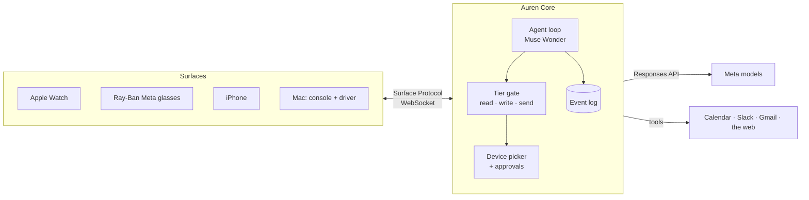

<p align="center"></p>

# Auren

**The layer between you and everything digital.** *Say it once. On anything.*

> *"Hey Muse, I'm running 15 late. Tell office hours, push my 3 PM, and draft the reply to Prof. Lee."*

Auren is one Muse-powered agent and one live session across your **Apple Watch, Ray-Ban Meta glasses, iPhone and Mac**. You say "Hey Muse", and one sentence gets done across all your apps. The task follows you from device to device.

**Why "Auren".** From *aura*, the field around a person, and *aurum*, gold: the golden layer around you, which every app and device speaks through.

> Built for the **Meta Global AI Developer Hackathon** (Oct 26 to Nov 4, 2026) · Indie track · Theme: *Build for Your World*
> Uses Muse models from Meta: **Muse Wonder · Muse Spark · Muse Spark Open · Muse Glimmer · Muse Voice Transcribe · SAM 3.1**. Every use is listed in [MUSE.md](MUSE.md).

## The idea
Meta's Muse agent lives on Meta's devices. Auren brings Muse models to **every device you already own**:
1. **Any device.** A device joins with a one-message manifest ([Surface Protocol](spec/surface-protocol.md)). A new surface takes [about 20 lines](spec/examples/minimal-surface.html).
2. **The task follows you.** Look through the glasses, approve on the watch, read the receipt on the phone. If a device drops, its pending approval moves to the next best one.
3. **Every app.** Auren uses APIs where they exist and Muse Wonder computer use where they don't.

**Core enforces safety, not the model.** Reads run on their own. Writes run on their own, with a receipt and an **Undo**. Sends always wait for a **tap**; a spoken yes never sends. Email, chat and web content reaches the model only as untrusted data. Computer use stops before any commit and never solves a CAPTCHA.

## The Golden Path
Five commands are the whole product. Each one has an eval case, and [docs/golden-paths.md](docs/golden-paths.md) has the pass criteria.

| | Where | Command |
|---|---|---|
| **GP1** | Apple Watch | "I'm running 15 late. Tell office hours on Slack, push my 3 PM block, and draft a reply to Prof. Lee." |
| **GP2** | Glasses | Looking at a poster: "Add this, and invite Priya." |
| **GP3** | Handoff | Take the glasses off mid-reply. The reply continues on the watch. |
| **GP4** | iPhone + Mac | "Find a table for two near there at 8 and hold it." |
| **GP5** | Mac | "What did I get done today?" then "Undo the calendar move." |

## How it works

Devices are tools: on every turn, Core rebuilds the model's tool inventory from the devices online and the apps connected. The full design is in [ARCHITECTURE.md](ARCHITECTURE.md).

## Status
| Piece | State |
|---|---|
| Core: event log, Surface Protocol, presence, device picker, approval handoff | ✅ working, tested |
| Agent loop: Muse Wonder, parallel tool calls, namespaces + `tool_search`, tier gate, receipts, undo | ✅ working against scripted turns; live Muse run pending an API key |
| Demo world: Calendar, Slack, Gmail (in memory, fictional people) | ✅ |
| Web console (acts as a phone, watch or glasses per tab) | ✅ on brand v1 |
| iPhone and Apple Watch apps: timeline, approvals, speech | ✅ build for the Simulator; on devices from Day 4 |
| Commit guard and CAPTCHA stop for computer use | ✅ tested |
| Router output schema and labelling rubric · 10 eval cases, checked in CI | ✅ |
| Live Google and Slack connectors | ⏳ Day 2 |
| Voice (Muse Voice Transcribe) · glasses (Wearables toolkit) | ⏳ Days 3–5 |
| Computer-use runner and driver · Auren Memory (Spark Open) · Auren Router (Glimmer) | ⏳ Days 6–7 |

**Tests:** 38 across four suites (Core 17, AurenKit 10, driver 6, router 5). No API key or device needed.

## Run it
Requires Node 24+. The Apple apps also need Xcode 27 and XcodeGen; the router needs uv.

```bash
make setup     # installs everything, turns on the secret scan, creates .env
               # then add MODEL_API_KEY from dev.meta.ai to .env
make dev       # Core and the console on http://127.0.0.1:8787
make test      # all four test suites
```

- Open **http://127.0.0.1:8787/** for the console. Open a second tab at **/?kind=watch** to get a "watch".
- Send a command from one tab and approve it on the watch. Tick **go offline** on the watch to watch the approval move.
- iPhone and Apple Watch: `make apple`, then open `apps/apple/Auren.xcodeproj` ([details](apps/apple/README.md)).
- Set `AUREN_TOKEN` in `.env` to let real devices reach Core on your network ([runbook](docs/runbook.md)).

## Repo
```
core/            Auren Core: TypeScript on Node, Hono, ws, zod, node:sqlite, OpenAI SDK → api.meta.ai/v1
apps/web/        the console surface, served by Core
apps/apple/      iPhone + Apple Watch apps (SwiftUI, XcodeGen) and AurenKit, the shared Swift package
driver/          computer use on the Mac: the commit guard today, the Playwright driver on Day 6
router/          Auren Router: output schema, labelling rubric; Glimmer fine-tune on Day 6
eval/            golden-path and safety cases, checked by Core's tests; the runner on Day 7
spec/            Surface Protocol v0 and the 20-line example surface
brand/           palette, mark, tokens and naming
docs/            golden paths, demo runbook
ARCHITECTURE.md  the full design: components, the five golden paths, safety, presence, build order
DEVELOPING.md    setup, environment, tests and conventions
MUSE.md          every Meta capability used, and where it is in the code
```

## Built during the hackathon
Everything in this repository was written during the event, starting after the kickoff on Oct 26, 2026, and the commit history is the record. No code was carried over from earlier projects. The API latency spikes written before the event are kept outside this repository. Third-party libraries are listed in `core/package.json`, `driver/package.json`, `router/pyproject.toml` and `apps/apple/AurenKit/Package.swift`.

| Date | Built |
|---|---|
| Oct 26 | Surface Protocol v0 · Core (event log, presence, device picker, handoff, tier gate, receipts, undo) · Muse agent loop with namespaces + `tool_search` + parallel calls · demo world · web console · architecture · brand v1 · iPhone and Apple Watch apps · commit guard · router schema · eval cases · CI |

## License
MIT
