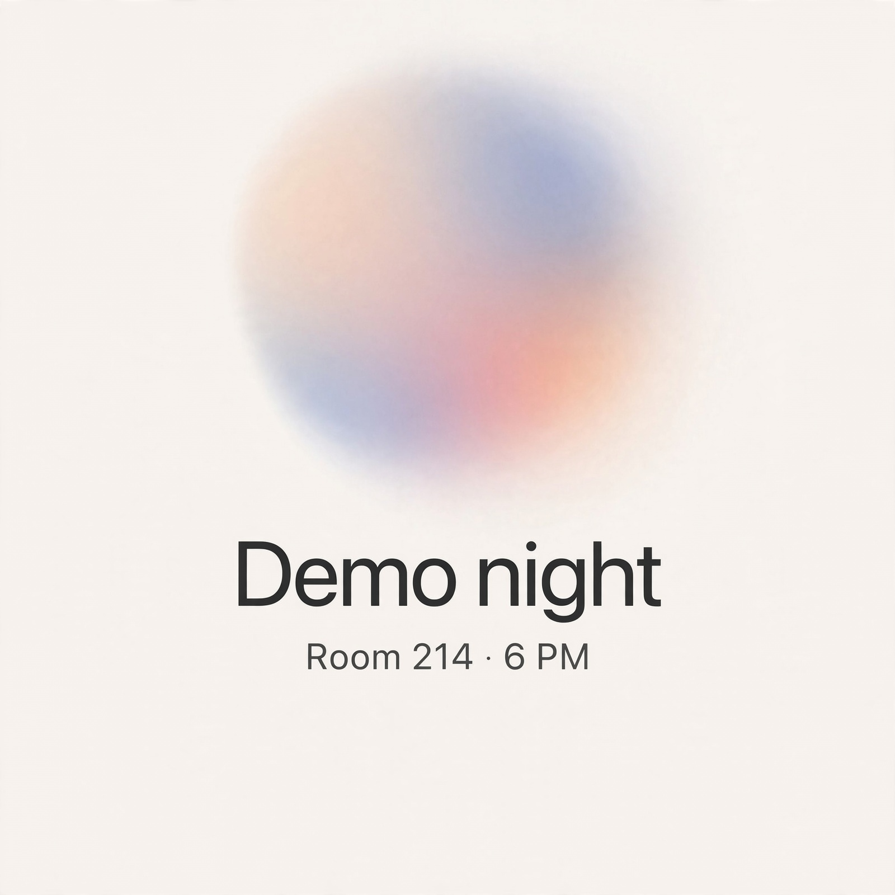

# Muse Image (`muse-image-1.0`)

Tested live against `https://api.meta.ai/v1` on 2026-11-04 with the OpenAI Node SDK (`openai@7`). `GET /models` lists it next to `muse-wonder-1.0`, `muse-spark-1.3`, `sam-3.1` and `muse-voice-transcribe-1.0`.

## Request shape

Works with `images.generate`, the OpenAI Images API shape:

```ts
const r = await client.images.generate({
  model: "muse-image-1.0",
  prompt: "A minimal, Apple-like event invitation card. ...",
  size: "1024x1024",       // an aspect-ratio hint; see below
  output_format: "jpeg",   // "webp" (default) | "png" | "jpeg"
});
// r = { created, data: [{ b64_json }], output_format, background: "opaque",
//       usage: { input_tokens, output_tokens, total_tokens } }
```

| Parameter | Observed |
|---|---|
| `output_format` | Default `webp`. `png` and `jpeg` work (checked by magic bytes). PNG is about 2.6 MB, JPEG about 220 to 440 KB, WebP about 240 to 280 KB. |
| `size` | Treated as an aspect ratio, not exact pixels. `1024x1024`, `512x512` and `2048x2048` all return **1600x1600**. `1536x1024` returns **1920x1280**. `1024x1536` is accepted (portrait). |
| `response_format: "url"` | Works; returns `data[0].url` instead of `b64_json`. |
| `n: 2` | Works; returns two images, and usage roughly doubles. |
| `quality` | **Rejected**: `400 unknown parameter 'quality'`. |
| Cost fields | `usage.input_tokens` (about 9,500 to 9,900 per image, almost all fixed overhead), `output_tokens` (about 460 to 750), `total_tokens`. There's no price or dollar field. |

**Responses API:** `responses.create({ model: "muse-image-1.0", input })` also works. Its output is `reasoning`, `message` and then `image_generation_call` with a base64 `result` (about 333 KB), in about 7.0 s. The `image_generation` tool on `muse-spark-1.3` (`tools: [{ type: "image_generation" }]`) returned `image_generation_call` items with `status: "failed"` and no result in both tries. Auren therefore uses `images.generate`.

## Latency

Wall clock from this Mac, one image per call:

| Call | ms |
|---|---|
| First invite card (1024x1024, webp) | 5,916 |
| png / jpeg / 3:2 / 2:3 / 512 / url / n=2 (run in parallel) | 5,980 to 7,500 |
| Responses API, `muse-image-1.0` | 6,989 |
| Auren's `createInviteCards` end to end (describe + generate + encrypt + store) | 7,458 |

Expect **6 to 7.5 s**. That's longer than a Google Calendar PATCH, which is why the card runs beside the invite and never in front of it.

## Quality

Very good for this use. Both runs (the probe and Auren's own prompt) rendered the exact text ("Demo night", "Room 214 · 6 PM", including the middle dot), in clean, well-kerned sans-serif type. The layout was centered, with a soft gradient orb, an off-white ground and no added logos or stray text.



`muse-image-invite.jpg` came from `createInviteCards` with the production prompt. The first probe is at `film/muse-image-invite.png` in the main checkout.

## In Auren: invite cards (opt-in)

- `AUREN_INVITE_CARDS=true` turns it on (off by default). `AUREN_IMAGE_MODEL` defaults to `muse-image-1.0`. `AUREN_INVITE_CARD_WAIT_MS` defaults to 9000.
- `core/src/vision/cards.ts`: `createInviteCards` builds the prompt from the event's own title, place and time (Google lookup when connected; otherwise a generic card). Invitee emails never go to the image model.
- The card **starts only after the send-tier tap is approved**, runs in parallel with `calendar.invite`, and the tool never waits for it. Once the invite succeeds, the receipt waits at most `AUREN_INVITE_CARD_WAIT_MS` for the card and carries `card_id` if one is ready. If the card fails or runs late, the receipt has no `card_id` and the invite is unchanged.
- Storage: `CropStore` of kind `"card"` (table `cards`, ids `card_<16 hex>`), AES-256-GCM under `derive(master, "cards")`, its own HKDF purpose separate from `crops`.
- Served at `GET /v1/cards/:id` as `image/jpeg`, the same pattern as `/v1/crops/:id`.
- Tests: `core/src/vision/cards.test.ts` uses a fake image client to cover success, failure, timeout, a declined tap, scoping to `calendar.invite`, key separation and the route.
